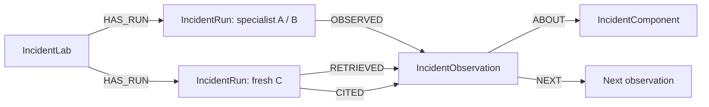

# SwarmLab

**Shared experience, observable decisions.** SwarmLab tests whether a fresh agent can use another agent’s experience without inheriting its conversation. FalkorDB stores observations, their provenance, and the evidence retrieved and cited by each consumer.

**Graph Hacks 2026 — Track 02: Agent Memory and Coordination**

Repository: https://github.com/jaipagdhare/graph-hacks

## What you can run

- **Incident lab:** independent Gemini investigators produce histories; fresh agents diagnose the same outage with no memory, chronological shared history, or graph-grouped evidence. The simulator measures recovery, lost jobs, and actions. New trials include before/after measurements and a recovery turn.
- **Maze lab:** three robot bodies investigate a switch-and-gate world. Local symbolic learning and transfer need no model calls; optional Gemini control and sleep preparation use the same persistent graph.
- **Audit trail:** inspect exact model contexts, actual action outcomes, token receipts, and the path from a decision to its evidence. Quota interruptions are incomplete trials, not scored repair failures.

This is an experimental prototype. Shared memory is not guaranteed to improve performance. [Measured results and limitations](docs/RESULTS.md) distinguish actual Gemini runs from automated tests.

## Local setup (Linux, macOS, or Windows with WSL2)

Requirements: Python 3.11+, Docker with Compose v2, and internet access for dependency downloads. Tested with Python 3.14. A Gemini API key with available quota is needed only for live model experiments. Docker Desktop users should enable WSL integration.

```bash
git clone https://github.com/jaipagdhare/graph-hacks.git
cd graph-hacks
python3 -m venv .venv
.venv/bin/python -m pip install -r requirements.lock
.venv/bin/python -m pip install -e . --no-deps
cp .env.example .env
docker compose up -d --wait
.venv/bin/python -m swarmlab doctor
.venv/bin/python -m swarmlab serve --port 8001
```

Open **http://127.0.0.1:8001/**. FalkorDB Browser is at **http://localhost:3000/**; select graph `swarmlab_demo` after an experiment creates records. Redis/FalkorDB is on localhost:6379. The Compose volume persists graph data across restarts. If those ports are already occupied by your FalkorDB instance, use it instead of starting a second one.

The default `.env.example` uses local FalkorDB without a password or TLS. Set `GEMINI_API_KEY` in your local `.env`, or use **Connections** in the app. The saved model is `gemini-3.5-flash-lite`; availability/quota depends on your project. `MODEL_NAME` can be edited locally. Do not commit `.env`. Environment variables override `.env` values. For a cloud database, configure its host, port, username, password, and TLS as specified by the provider.

`doctor` verifies a real graph write/read/delete and spends **zero model calls**. The UI's **Check connections** button also tests the model and consumes one request. Tests use explicit model doubles and do not require an API key or a running database:

```bash
.venv/bin/python -m pytest -q
```

Stop the app with Ctrl+C. `docker compose stop` preserves data. Local setup is the submission’s deployment path. The app is bound to loopback and has no public authentication layer; it is not configured as an internet-facing hosted service.

## First incident experiment

1. Open **Incident lab** and create a new lab (zero calls).
2. Choose **Specialists only** (up to four requests), or **Run full pilot** (up to thirteen requests).
3. A and B receive isolated incidents and no historical memory. A fixed local protocol measures authentication and queue state before and after their chosen intervention. It does not prescribe a repair.
4. Fresh C trials use identical simulator state and tools under no-memory, raw-history, and graph-evidence conditions. Each gets up to two probes, three initial repair actions, and, if still unsuccessful, one recovery decision with up to three actions.
5. Expand a run to inspect its exact context, decisions, observations, and citations. Recovery and work preservation are scored separately from model explanations.
6. Try authentication-only and queue-only targets as additional cases. A single combined-fault pilot is not a general result.

**Quota and resume:** automatic incident retries are disabled. All dispatched/reserved requests count toward the lab cap, including failures. When quota returns, select the saved lab and click **Resume saved work**. The explicit “additional request budget” field increases the cap by only that amount (0–3). Completed phases are reused; received responses can be replayed locally without another request. A request interrupted before its response was saved may need to be sent again, and both attempts remain counted. Existing protocol-2 labs retain their original two-round design; new labs use protocol 3. Model identity and simulator reconstruction must match before resuming.

Gemini requests share the existing process-wide five-second spacing. Other processes are outside this limiter. Maze requests retain their bounded rate-limit retry policy; incident requests make one HTTP attempt each.

## Maze experiment

Open **Maze lab**. For zero-API runs, use **Learn with local experiments**, then **Transfer locally** with a fresh seed. New local runs save evaluator frames; select a recording, click **Load replay**, then **Play recorded actions** to inspect every step. Playback is explicitly labeled and does not make model calls. All learning comes from sensor observations stored in FalkorDB. The local controller is symbolic, not an LLM.

For Gemini, either retrieve **Local learning from FalkorDB** directly, or use **Explore → Prepare during sleep → Fresh-context transfer**. Sleep output is checked against cited sensor views and rejected if unsupported. Never interpret an invalid artifact or a provider error as a successful learning result. Prepared graph memory and local symbolic memory are separate paths.

## Graph data model



- `IncidentLab`: seed, evaluator-only target variant, protocol version and request cap.
- `IncidentRun`: producer/condition, model, status, saved phases, exact contexts, decisions, usage, and score.
- `IncidentObservation`: actual before/action/outcome/after record, linked to its producer and component.
- `IncidentComponent`: lab-scoped service identity used to group evidence.
- Maze: `Episode → Observation`, `SleepRun → Hypothesis → Observation`, and `ProcedureVersion → Hypothesis`; local `LocalRule → LocalSample → Observation` provides sensor-backed rule provenance.

The graph is the memory source of truth. JSON properties in graph nodes preserve complete structured records; local JSON exports are optional reports, not learning inputs. Tenant-like isolation is at lab-ID scope, not a production access-control guarantee.

See [full graph model](docs/GRAPH_MODEL.md), [architecture](docs/ARCHITECTURE.md), and the executable [Cypher queries](queries/README.md). The product uses scoped graph traversals and provenance links; it does not claim to use PageRank or a graph neural network.

## Submission materials

**Primary demo:** [Maze learning, transfer, and FalkorDB evidence](docs/maze-demo.webm). The video replays actual recorded actions, shows a successful unseen-seed transfer, and runs the evidence query in FalkorDB Browser. It uses the local symbolic controller, not Gemini.


- [Submission checklist and ready-to-paste description](docs/SUBMISSION.md)
- [Demo recording and narration guide](docs/DEMO_SCRIPT.md)
- [Actual results and limits](docs/RESULTS.md)
- [Graph queries](queries/README.md)

Inspired by [Sleep-time Compute](https://arxiv.org/abs/2504.13171). SwarmLab's bounded experiments do not reproduce that paper's results.


## AI assistance and hackathon eligibility

**AI disclosure:** OpenAI Codex assisted extensively with design, substantial code generation, debugging, automated tests, documentation, and video tooling. Participant project direction and hands-on feedback are described in [AI_ASSISTANCE.md](docs/AI_ASSISTANCE.md). This is not represented as entirely hand-written code or independently human-verified work.

See the [rules audit](docs/RULES_AUDIT.md), [data provenance](docs/DATA_PROVENANCE.md), and [participant explanation guide](docs/UNDERSTANDING.md). The participant must personally confirm the implementation start time, ownership, meaningful contribution and technical understanding. Publication and final submission are pending; the organizer determines eligibility.

To verify that the graph does real work without modifying the production graph or using model calls:

```bash
.venv/bin/python scripts/audit_graph_dependency.py
```
