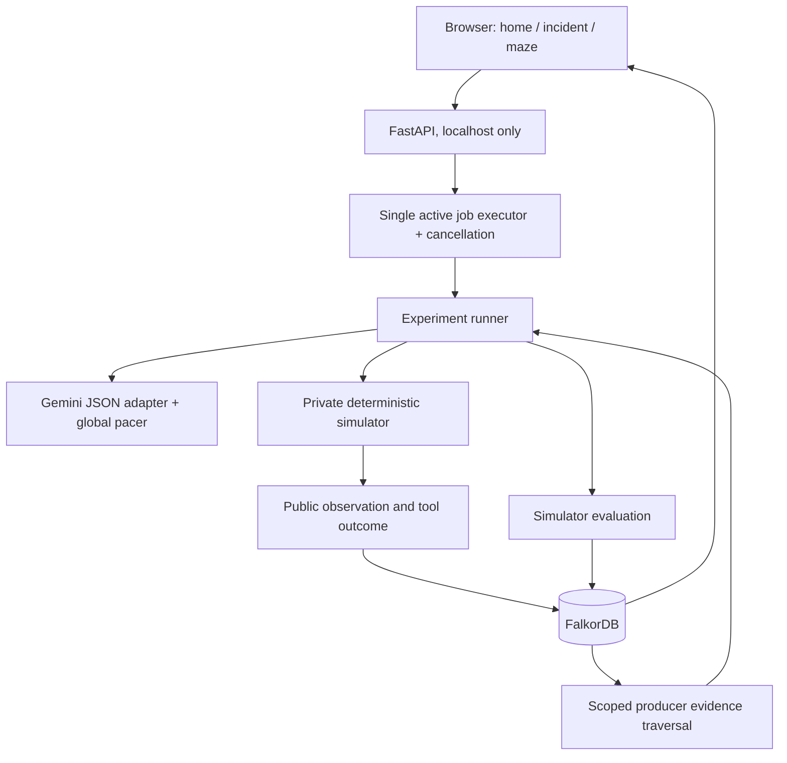

# Architecture

- `incident.py`: simulator, model plan schema, graph persistence, evidence retrieval, checkpoint/resume, measurement protocol.
- `jobs.py`: shared serial job queue; no concurrent maze/incident model runs in one server.
- `server.py`: local endpoints, input validation, same-origin checks, static pages, configuration.
- `model.py` / `pacing.py`: provider API boundary, structured output, usage receipts, cancelable pacing. Incident retries are disabled.
- `memory.py`, `awake.py`, `sleep.py`, `local_learning.py`, `local_runner.py`: maze lifecycle and evidence-backed memory.
- `static/`: framework-free pages; no build step or remote frontend dependency.

## Experiment controls

C's no/raw/graph conditions have identical initial state, tool definitions, phase budgets and model. Fresh context means a fresh request context, not a newly trained model. Calls are independent requests to the same configured model. Run ordering is fixed in this prototype; model randomness and order effects are limitations.

New specialist traces include fixed baseline and post-intervention probes, labeled as protocol measurements. These cost simulator actions but no extra model requests. Intervention choice remains model-generated. A recovery turn is available equally to all consumer conditions if initial repair fails.

Raw vs graph currently isolates chronological vs component-grouped presentation of the same evidence. It is not a benchmark of advanced retrieval selection. A no-memory win is a valid result. Local symbolic maze success cannot be used as evidence that Gemini benefited from memory.

## Hosting boundary

The submitted deployment path is local. The API binds to loopback, uses TrustedHost and same-origin checks, and has no user authentication or per-user permissions. A public hosted version would require authentication, credential separation, budgets, durable job ownership and HTTPS. No real infrastructure is modified by incident actions.
